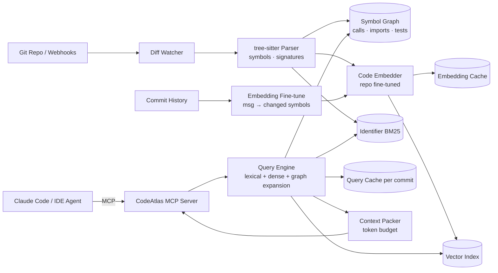

# CodeAtlas: System Architecture

> A codebase intelligence engine for coding agents: AST-aware indexing, code-tuned embeddings, a symbol graph and context packing, served over MCP so Claude Code and IDEs understand huge monorepos.
>
> **Concepts:** `MCP`, `RAG`, `Embeddings`, `Tokenization`, `Context Window`, `Caches`, `Fine Tuning`, `Vector Database`

## 1. High-Level View

A Git-aware indexer parses changed files into symbols, updates the symbol graph, BM25 and vector indexes. A query engine combines lexical, dense and graph signals, and the packer produces budgeted context. Everything is exposed through an MCP server, with caches at embedding, query and pack levels.

## 2. Components

| Component | Responsibility |
|---|---|
| Diff watcher | Consumes push webhooks; computes changed files per commit. |
| Parser | tree-sitter grammars; extracts symbols with spans, signatures, docs. |
| Symbol graph | Edges from import resolution, call-site matching, test naming conventions and coverage data. |
| Embedder | Base code embedding model + LoRA/full fine-tune on repo pairs. |
| Query engine | RRF of BM25 + dense; personalised PageRank expansion from seed symbols. |
| Context packer | Budget-aware rendering (full body vs signature vs name) by distance and score. |
| MCP server | Tools/resources; auth for remote mode. |

## 3. Request / Data Flow

1. Push → diff watcher → re-parse changed files only → update graph/indexes (content-hash cache skips unchanged symbols).
2. Agent asks `find_relevant_code(query, budget=6000)`.
3. Query cache check (key includes commit SHA).
4. BM25 + dense top-50 → RRF → graph expansion (callers/callees/tests) → re-score.
5. Packer renders top symbols within budget; returns with file paths and line ranges.

## 4. Data Stores

| Store | Holds | Why |
|---|---|---|
| SQLite/Postgres | Symbols, graph edges | Relational + recursive queries. |
| LanceDB/Qdrant | Symbol embeddings | ANN. |
| Tantivy | Identifier index | Fast lexical. |
| Redis/LRU | Query + pack caches | Speed. |

## 5. Deployment Topology

- Local (single repo, stdio MCP) or team server (monorepo, HTTP MCP) inside the company network.
- GPU optional (embedding fine-tune/indexing).

## 6. Scaling Strategy

- Shard by top-level directory/package for monorepos; scatter-gather queries.
- Embedding batch jobs on GPU for initial index.

## 7. Security & Privacy

- On-prem only; respects repo permissions (per-user access via Git host API).
- Secrets detection: files matching secret patterns excluded from index.

## 8. Observability

- Index lag, query latency, cache hits, recall on benchmark per release, token savings reported by clients.

## 9. Failure Modes

| Failure | Detection | Response |
|---|---|---|
| Parser fails on a file | Parse error | Fallback to line-window chunks for that file. |
| Index behind HEAD | Lag metric | Tools report `indexed_commit`; agent can fall back to grep. |
